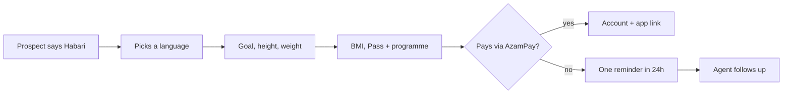

# Feature spec: Programmes, Local Nutrition and WhatsApp onboarding

| | |
|---|---|
| Version | 0.2 (repo export, 17 Nov 2026) |
| Owner | Nassor (FitFlex Africa) |
| Status | Draft: open questions in §9 need owner answers before Phase 1 build |
| Branch model | Work PRs into `release-candidate`; never `main` (see `CLAUDE.md`) |
| Working copy | Claude Doc "FitFlex Africa — Feature Spec" (v0.1). This file supersedes it. |

**Changes from v0.1**
- Payments use **AzamPay** (already built in `fitflex-functions`, dormant behind `AZAMPAY_PAYMENTS`), not an undecided aggregator.
- Pass visit counts are **not hard-coded** here. Production values in `fitflex-functions/src/shared/constants.mjs` are the source of truth.
- The architecture section was rewritten for the real stack (Node/Postgres/Firebase backend, Next.js portal, Flutter app). v0.1 wrongly assumed Supabase and Expo.
- A new §2 maps each feature onto what already exists (Training Plans, exercise library, QR check-in, Communications), so the work extends existing modules instead of rebuilding them.

---

## 1. Overview

FitFlex adds three features. Two give members a reason to open the app between gym visits, and one brings new members in through WhatsApp:

1. **FitFlex Programmes**: published, fixed-length day-by-day programmes built on the existing Training Plans engine.
2. **Local Nutrition**: meal logging against a Tanzanian food database that FitFlex owns.
3. **WhatsApp onboarding bot**: a prospect goes from "Habari" to a paid Pass inside WhatsApp.

A Platform Pass covers a fixed number of gym visits a month. On the days in between, a member has no reason to open the app, and those quiet days are when people churn. Programmes and Nutrition fill those days. The WhatsApp bot works at the front of the funnel.

The ideas come from a review of [Open-Code-Crafters/FitFlex](https://github.com/Open-Code-Crafters/FitFlex) (MIT licence). Its ideas were adapted; no code or media was copied.

| Feature | Member problem | Business outcome |
|---|---|---|
| Programmes | "I don't know what to do on days I'm not at the gym" | More active days per member; new trainer income |
| Local Nutrition | Calorie apps don't know ugali, wali or maharage | Daily habit loop; a local food dataset competitors lack |
| WhatsApp onboarding | Downloading an app is friction before the value is clear | Cheaper acquisition; Pass sign-up inside the chat |

## 2. Fit with the current codebase

Read this before planning. Most of the Programmes foundation already exists.

| Area | What already exists (`fitflex-functions`) | What this spec adds |
|---|---|---|
| Exercise library | `src/shared/exercise-library.mjs`: bilingual (`i18n.sw`), target areas, equipment, environment, goals; admin via `exercise-admin-service.mjs` | Demo clip URL per exercise; a body-map grouping in the app |
| Plans | `services/training/training-plan-service.mjs` (recommended plans, one `Workout` per session); `trainer-plan-service.mjs` (trainer offers a plan to a client) | **Published catalogue programmes** that any member can enrol in, free or paid, with fixed length and day order |
| Progress | `shared/member-progress.mjs` streaks (EAT, UTC+3); workouts feed Activity, goals, challenges | A gym day of a programme is completed by a check-in |
| Check-in | `check-in-rules.mjs`, `check-in-service`, QR tokens (`qr-token` specs); gym QR promoted 16 Nov | Hook: check-in marks today's programme gym day done |
| Payments | AzamPay MNO checkout `POST /me/payments/:id/mobile-money`, webhook `/webhooks/azampay`; `AZAMPAY_TRAINER_PRODUCTS` | Programme purchase as a new payable product; the bot reuses the same endpoint |
| WhatsApp | `whatsapp-service.mjs` (Africa's Talking direct sends: OTP, bookings); `whatsapp-channel-service.mjs` (Communications, consent, kill switch, **no provider yet**) | An **inbound** conversational flow; needs the provider decision in §9 |
| Onboarding | `onboarding-service.mjs`, fitness goals in `training-taxonomy.mjs` | Same goals and IDs reused in the bot; no second list |
| Nutrition | Nothing (activity has `calories` burned only) | Everything in §5 |

## 3. Goals, non-goals and KPIs

The main goal is more app-active days per paying member, up to at least 22 days a month.

**Goals**
- Give members something useful to do in the app on days they don't visit the gym
- Build a Tanzanian food dataset that FitFlex owns
- Let a prospect go from "hello" to a paid Pass without leaving WhatsApp
- Open a new income stream for trainers through programmes they write and sell

**Non-goals for v1**
- Medical diet plans for health conditions (general wellness guidance only)
- New wearable integrations beyond the existing device steps
- Video streaming infrastructure (short clips on a CDN)
- Kenya and Uganda food data (Tanzania first)

**KPIs.** Baselines come from current analytics; targets are 90 days after launch and are starting assumptions for the owner to confirm.

| KPI | Baseline | Target |
|---|---|---|
| App-active days per paying member, per month | To measure | +30% |
| Active Pass holders who start a programme | 0 | 35% |
| Programme day-7 completion rate | n/a | 50% |
| Members logging a meal at least 3 days a week | 0 | 20% |
| Foods in the Tanzanian database | 0 | 400 |
| WhatsApp conversations that reach a Pass offer | n/a | 40% |
| WhatsApp offer-to-paid conversion | n/a | 8% |
| Cost per paid acquisition, WhatsApp vs paid social | To measure | 40% lower |
| Month-2 Pass renewal rate | To measure | +10 points |

## 4. Feature 1: FitFlex Programmes

A programme is a published, fixed-length plan, such as "21-day home strength" or "30-day Ramadhan-friendly cardio". It is followed one day at a time and mixes gym days, home days and rest days. FitFlex publishes free starter programmes. Verified trainers publish paid ones and earn a revenue share.

**Implementation note.** A programme day is an existing `Workout` definition. Enrolling creates the member's plan and workouts the same way `training-plan-service` does, so Activity, streaks, goals and challenges need nothing new.

**How it works**
1. A member picks a programme by goal (`FITNESS_GOAL_IDS`), level, length and environment (none / home / gym).
2. Each day shows its workout: exercises, sets/reps/time, rest timer, demo clip and Swahili/English cues.
3. Gym days are completed by a check-in at any partner gym that day.
4. Home days are completed by finishing the workout in the app. Streak and weekly ring update.
5. At the end, the member gets a summary, a share card and a suggested next programme.

**Requirements**

| ID | Requirement | Priority |
|---|---|---|
| FR-P01 | Programme catalogue with filters for goal, level, length and environment | High |
| FR-P02 | Day view: exercises, sets/reps/time, rest timer, demo clip | High |
| FR-P03 | A gym day is completed automatically by a valid check-in on the same local day (EAT) | High |
| FR-P04 | Streaks, weekly ring and an end-of-programme summary, built on `member-progress` | High |
| FR-P05 | Exercise library extended with clip URLs; body-map grouping in the app | High |
| FR-P06 | Trainer portal: build a programme from library exercises and saved workouts, set price, submit for review | Med |
| FR-P07 | Paid programmes bought through AzamPay, or included with higher Passes (see §9) | Med |
| FR-P08 | Trainer revenue share per completed enrolment, paid with trainer settlements | Med |
| FR-P09 | Day content downloadable for offline use | High |
| FR-P10 | Push and WhatsApp reminders at the member's chosen time, through Communications consent rules | Med |
| NFR-P01 | A day's clips under 15 MB in total; low-data mode serves stills | High |

**User stories**

| ID | Story | MoSCoW |
|---|---|---|
| US-01 | As a Basic Pass member, I want a home workout on days I don't go to the gym so I keep my streak. | Must |
| US-02 | As a member, I want my gym check-in to tick off the day so I don't log it twice. | Must |
| US-03 | As a trainer, I want to publish a paid programme so I earn beyond my gym sessions. | Should |
| US-04 | As a member on limited data, I want to download the week's workouts on Wi-Fi. | Must |
| US-05 | As a member, I want to share my finished programme so friends see my progress. | Could |

**Acceptance (US-02).** Given a member enrolled in a programme with a gym day today, when a check-in is accepted at any partner gym, then today's day is marked complete within 1 minute and the streak updates. A voided check-in reverses it.

## 5. Feature 2: Local Nutrition

Members log meals in local terms, such as "sahani ya wali na maharage" or "chapati 2, chai ya maziwa". They get calories and macros from a Tanzanian Food Database (TFD) that FitFlex owns. A global nutrition API covers only the foods TFD lacks, and is called server-side.

**Tanzanian Food Database**
- Seed list of about 400 foods and dishes: staples (ugali, wali, ndizi, viazi, mihogo), proteins (maharage, dagaa, samaki, nyama choma, mishkaki), street food (chipsi mayai, mandazi, chapati, sambusa), drinks (chai, juisi, soda)
- Each entry has Swahili and English names, aliases and local spellings, and **local portions** (sahani, kikombe, kipande, mwiko) in grams
- Values come from published East African food composition tables. A contracted nutritionist reviews mixed dishes.
- Shop products and partner menus can link to TFD entries

**Logging and suggestions**
1. Log by text, voice note or photo. AI splits the input into TFD items and portions; the member confirms before saving.
2. A daily view shows calories and macros against a target set from goal, height, weight and activity.
3. Weekly suggestions respect the member's goal, budget band, diet choice and stated allergies, using local meals and nearby options.

**Requirements**

| ID | Requirement | Priority |
|---|---|---|
| FR-N01 | TFD with bilingual names, aliases and local portion units; admin-editable | High |
| FR-N02 | Natural-language meal logging in Swahili and English, member confirms before saving | High |
| FR-N03 | Photo meal logging (AI estimate, member confirms) | Med |
| FR-N04 | Daily calorie and macro summary against a target | High |
| FR-N05 | Global nutrition API fallback, server-side only | Med |
| FR-N06 | Weekly meal suggestions within a stated budget band | Med |
| FR-N07 | Shop and partner meals linked to TFD | Low |
| FR-N08 | Members report wrong values into an admin review queue | Med |
| NFR-N01 | Guidance-only disclaimer; no medical diet plans | High |
| NFR-N02 | Health inputs (allergies, weight) are sensitive personal data under PDPA 2022: explicit consent, encrypted, deletable, covered by account deletion and anonymisation | High |

**User stories**

| ID | Story | MoSCoW |
|---|---|---|
| US-06 | As a member, I want to type "ugali na samaki" and get calories without searching a list. | Must |
| US-07 | As a member, I want portions in sahani or kipande, not grams. | Must |
| US-08 | As a member saving money, I want meal ideas I can afford at a local mama ntilie. | Should |
| US-09 | As an admin, I want to review flagged food values before they go live. | Should |

**Acceptance (US-06).** Given TFD has "ugali" and "samaki wa kukaanga", when a member enters "ugali na samaki", then both items show with default portions and total calories within 3 seconds, and portions can be changed before saving.

## 6. Feature 3: WhatsApp onboarding bot

A guided chat on the FitFlex WhatsApp number turns a prospect into a paying member in about 3 minutes. It asks the prospect's goal, height and weight, recommends a Pass and a starter programme, and takes payment by AzamPay USSD push. Downloading the app comes after payment.

Entry points: click-to-WhatsApp ads, the gym QR codes already in production, and member referral links.

**Conversation design**
- Reply buttons and lists wherever possible, so prospects tap instead of typing
- Swahili by default; switch to English at any time
- BMI is a neutral starting point, never a judgement; the recommendation follows the stated goal and budget
- Existing members can use the same number: "Pass yangu" (visits left), "Gym karibu" (nearby gyms), today's workout, renewal
- "wakala" or "agent" hands over to a human in a shared inbox

**Requirements**

| ID | Requirement | Priority |
|---|---|---|
| FR-W01 | Flow: language, goal (`FITNESS_GOAL_IDS`), height and weight, BMI, Pass and programme recommendation | High |
| FR-W02 | Payment through the existing AzamPay flow (`POST /me/payments/:id/mobile-money`), confirmed by the verified webhook; confirmation posted back to the chat | High |
| FR-W03 | Account created or matched against the WhatsApp number using existing identity rules; app deep link signs the member in | High |
| FR-W04 | Entry source tagging (ad, gym QR, referral) for attribution | High |
| FR-W05 | One reminder after 24h for unpaid prospects, through Communications consent and template rules | Med |
| FR-W06 | Human handoff to a shared inbox with the transcript | Med |
| FR-W07 | Member self-service: visits left, nearby gyms, today's workout, renewal (early renewal starts when the current Pass ends) | Med |
| FR-W08 | Referral code per member; reward after the referred member's first paid Pass | Low |
| NFR-W01 | Opt-in recorded before any outbound template; STOP opts out (same as existing WhatsApp rules) | High |
| NFR-W02 | Scripted replies under 2 seconds | Med |

**User stories**

| ID | Story | MoSCoW |
|---|---|---|
| US-10 | As a prospect who saw an ad, I want to join and pay in WhatsApp without installing anything first. | Must |
| US-11 | As a gym owner, I want my front-desk QR code to bring members in and credit my gym. | Should |
| US-12 | As a member, I want to check visits left by sending one word. | Should |
| US-13 | As an ops agent, I want stuck chats handed to me with the full history. | Should |

**Acceptance (US-10).** Given a new number messages the FitFlex line, when the prospect completes the flow and approves the AzamPay prompt, then a member account and an active Pass exist, and the chat shows a confirmation and an app link that signs them in.

## 7. Architecture and data

Everything runs on the current stack: `fitflex-functions` (Node, Postgres via knex migrations in `db/migrations`, Firebase auth), `fitflex-portal` (Next.js), `fitflexmobile` (Flutter). Third-party keys stay in the backend secret store, never in the apps or the repo.

**New feature flags (all dormant by default)**

| Flag | Covers |
|---|---|
| `PROGRAMMES_CATALOGUE` | Catalogue, enrolment, check-in completion |
| `PROGRAMMES_PAID` | Trainer-authored paid programmes (needs `AZAMPAY_PAYMENTS`) |
| `NUTRITION_LOGGING` | TFD, meal logs, daily summary |
| `WHATSAPP_ONBOARDING_BOT` | Inbound flow, payment in chat, self-service |

**Proposed tables** (final names follow existing conventions; planner to confirm)

| Table | Holds | Links |
|---|---|---|
| `programmes` | Title (en/sw), goal, level, length, environment, price, author, status draft/review/live | trainers |
| `programme_days` | Day number, type gym/home/rest, workout definition | programmes |
| `programme_enrolments` | Member, programme, start date, current day, status | users, programmes, training plan |
| `programme_day_completions` | Day, source check-in/workout, timestamp | enrolments, check-ins, workouts |
| `foods` | TFD entry: names, aliases, nutrients per 100 g, source, verified | n/a |
| `food_portions` | Local unit and grams | foods |
| `meal_logs` | Member, time, raw input, items, totals | users, foods |
| `food_reports` | Flagged value, note, review status | foods |
| `wa_conversations` | Number, flow step, answers, source tag, opt-in time | users (after sign-up) |
| `referrals` | Code, referrer, referred, reward status | users |

Exercise clip URLs are a field on existing exercise entries, not a new table.

**Backend pieces**
- Inbound WhatsApp webhook and flow state machine, behind the Communications module's consent and kill switch
- Check-in hook: an accepted (non-voided) check-in completes today's programme gym day
- Meal parser: LLM call server-side, TFD lookup, global API fallback
- Programme purchase as an AzamPay payable product, approved through the same `adminPaymentService.decide` path

Changes to call out in PRs (per `CONTRIBUTING.md`): the check-in hook touches check-in logic; paid programmes touch pricing and trainer settlements.

## 8. Phasing and rollout

The WhatsApp funnel and free programmes ship first, because they bring in members and pay for the rest. Nutrition follows once TFD is verified. Paid trainer programmes come last.

| Phase | Weeks (estimate) | Scope | Gate to next phase |
|---|---|---|---|
| 1. Launch the funnel | 1–6 | WhatsApp bot with AzamPay; source tags on existing gym QR; free catalogue programmes; clip URLs; check-in completes gym days | AzamPay payments from chat reconcile 100%; check-in sync reliable |
| 2. Daily habit | 7–12 | Text meal logging (sw/en); TFD 400 verified; offline days and reminders; member self-service in chat | Food values verified; day-7 completion on track |
| 3. Trainer economy | 13–18 | Trainer portal paid programmes; revenue share in settlements; photo logging; meal suggestions; referrals | Owner decision |

Each phase follows the standard flow in `CLAUDE.md`: planner → design-agent → builders → reviewers → RC → UAT → owner go-ahead. Phase 1 can pilot at 3–5 partner gyms in Dar es Salaam.

## 9. Risks, dependencies and open questions

| ID | Risk | Mitigation |
|---|---|---|
| R-01 | Wrong food values damage trust | Published composition tables, nutritionist review, verified badge, member reports |
| R-02 | WhatsApp template rejections or limits slow the funnel | Approve templates early, one reminder only, build number quality before ads |
| R-03 | Health data mishandled (PDPA 2022) | Consent, encryption, deletion and anonymisation, nothing shared with trainers without the member's sharing permission |
| R-04 | Low programme completion | 7- and 14-day starters, chosen-time reminders, gym check-ins count automatically |
| R-05 | Weak or unsafe trainer programmes | Review before publishing, verified trainers only, ratings |
| R-06 | Mobile data cost | Wi-Fi download, low-data stills, short clips |
| R-07 | AI meal parsing mislabels local dishes | Member always confirms; corrections kept for improvement |
| R-08 | A sandbox AzamPay payment activates a real Pass | Keep `AZAMPAY_SANDBOX_SETTLES` on test servers only |

**Dependencies**
- DEP-01: Inbound WhatsApp provider chosen and number verified with approved templates
- DEP-02: AzamPay merchant KYC approved and production hosts issued; sandbox until then
- DEP-03: Contracted nutritionist and East African food composition data
- DEP-04: Partner trainers to film exercise clips
- DEP-05: Check-in events exposed to the programme hook

**Open questions for the owner**
- [ ] Inbound WhatsApp provider: Meta Cloud API (the "FitFlex AF" app) or Africa's Talking (already used for direct sends)?
- [ ] Are paid programmes included with Pro and higher Passes, sold separately, or both?
- [ ] Trainer revenue share (e.g. 60/40 or 70/30)?
- [ ] Do gyms whose QR brings in a member get a bonus on top of visit-based payouts?
- [ ] Do Phase 1 programmes need Ramadhan or other seasonal variants at launch?
- [ ] Who runs the human-handoff inbox, and during what hours?
