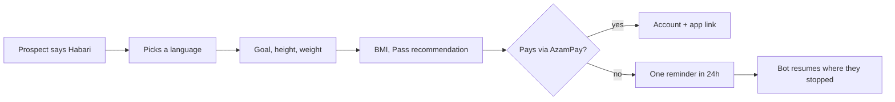

# Feature spec: WhatsApp onboarding bot

| | |
|---|---|
| Version | 0.4 (split from the combined spec v0.3, 18 Nov 2026) |
| Owner | Nassor (FitFlex Africa) |
| Status | Draft: owner decisions recorded in §8; the open items there block only the slices they affect |
| Branch model | Work PRs into `release-candidate`; never `main` (see `CLAUDE.md`) |
| Companion spec | [`programmes-nutrition.md`](programmes-nutrition.md): Programmes and Local Nutrition |

**Changes from v0.3**
- Split out of the combined spec `programmes-nutrition-whatsapp.md` so the bot can be planned, built and shipped on its own. Requirement, risk, dependency and decision IDs are unchanged.
- The bot no longer needs Programmes. A starter programme suggestion (FR-W01) and "today's workout" (FR-W07) are shown only when `PROGRAMMES_CATALOGUE` is on.

Earlier history (v0.1–v0.3) is in the git log of `docs/specs/programmes-nutrition-whatsapp.md`.

---

## 1. Overview

A guided chat on the FitFlex WhatsApp number turns a prospect into a paying member in about 3 minutes. It asks the prospect's goal, height and weight, recommends a Pass and takes payment by AzamPay USSD push. Downloading the app comes after payment.

Downloading an app is friction before the value is clear. Selling the Pass inside the chat should make acquisition cheaper, and gyms' front-desk QR codes become an entry point.

The ideas come from a review of [Open-Code-Crafters/FitFlex](https://github.com/Open-Code-Crafters/FitFlex) (MIT licence). Its ideas were adapted; no code or media was copied.

## 2. Fit with the current codebase

| Area | What already exists (`fitflex-functions`) | What this spec adds |
|---|---|---|
| WhatsApp | `whatsapp-service.mjs` (Africa's Talking direct sends: OTP, bookings); `whatsapp-channel-service.mjs` (Communications, consent, kill switch, **no provider yet**) | An **inbound** conversational flow on the Meta Cloud API (D-01) |
| Payments | AzamPay MNO checkout `POST /me/payments/:id/mobile-money`, webhook `/webhooks/azampay` | The bot starts the same checkout for a Pass |
| Onboarding | `onboarding-service.mjs`, fitness goals in `training-taxonomy.mjs` | Same goals and IDs reused in the bot; no second list |
| Check-in / QR | Gym QR codes in production (promoted 16 Nov) | Source tag so a gym QR scan that opens the chat is attributed to that gym |
| Programmes | Specified in [`programmes-nutrition.md`](programmes-nutrition.md); not built | Optional: programme suggestion and "today's workout" when `PROGRAMMES_CATALOGUE` is on |

## 3. Goals, non-goals and KPIs

**Goals**
- Let a prospect go from "hello" to a paid Pass without leaving WhatsApp
- Give existing members quick answers (visits left, nearby gyms, renewal) on the same number

**Non-goals for v1**
- Human handoff or a shared agent inbox (D-06)

**KPIs.** Baselines come from current analytics. Targets are 90 days after launch and are ASSUMPTIONS, set conservatively at the owner's request (D-07). Admins can change them in the portal (FR-K01, specified in [`programmes-nutrition.md`](programmes-nutrition.md) §3; whichever spec ships first builds it).

| KPI | Baseline | v0.2 draft | Target (v0.3, ASSUMPTION) |
|---|---|---|---|
| WhatsApp conversations that reach a Pass offer | n/a | 40% | 30% |
| WhatsApp offer-to-paid conversion | n/a | 8% | 5% |
| Cost per paid acquisition, WhatsApp vs paid social | To measure | 40% lower | 25% lower |

## 4. The bot

Entry points: click-to-WhatsApp ads, the gym QR codes already in production, and member referral links.

**Conversation design**
- Reply buttons and lists wherever possible, so prospects tap instead of typing
- Swahili by default; switch to English at any time
- BMI is a neutral starting point, never a judgement; the recommendation follows the stated goal and budget
- Existing members can use the same number: "Pass yangu" (visits left), "Gym karibu" (nearby gyms), renewal, and today's workout when Programmes is on
- The bot handles every conversation; there is no human handoff (D-06). When it doesn't understand, it shows the menu of options again instead of a dead end

**Requirements**

| ID | Requirement | Priority |
|---|---|---|
| FR-W01 | Flow: language, goal (`FITNESS_GOAL_IDS`), height and weight, BMI, Pass recommendation. When `PROGRAMMES_CATALOGUE` is on, it also suggests a starter programme | High |
| FR-W02 | Payment through the existing AzamPay flow (`POST /me/payments/:id/mobile-money`), confirmed by the verified webhook; confirmation posted back to the chat | High |
| FR-W03 | Account created or matched against the WhatsApp number using existing identity rules; app deep link signs the member in | High |
| FR-W04 | Entry source tagging (ad, gym QR, referral) for attribution | High |
| FR-W05 | One reminder after 24h for unpaid prospects, through Communications consent and template rules | Med |
| FR-W06 | ~~Human handoff to a shared inbox~~ Removed (D-06): the bot handles everything. Unrecognised input re-shows the current step's options; failed or pending payments can be retried from the chat | Med |
| FR-W07 | Member self-service: visits left, nearby gyms, renewal (early renewal starts when the current Pass ends); today's workout only when `PROGRAMMES_CATALOGUE` is on | Med |
| FR-W08 | Referral code per member; reward after the referred member's first paid Pass | Low |
| FR-W09 | A gym or partner whose QR or link brings in a paying member earns a referral bonus, recorded and paid **separately** from visit-based payouts and gym settlements (D-04); amount and rules still open (§8) | Low |
| NFR-W01 | Opt-in recorded before any outbound template; STOP opts out (same as existing WhatsApp rules) | High |
| NFR-W02 | Scripted replies under 2 seconds | Med |

**User stories**

| ID | Story | MoSCoW |
|---|---|---|
| US-10 | As a prospect who saw an ad, I want to join and pay in WhatsApp without installing anything first. | Must |
| US-11 | As a gym owner, I want my front-desk QR code to bring members in and credit my gym. | Should |
| US-12 | As a member, I want to check visits left by sending one word. | Should |
| ~~US-13~~ | Removed (D-06): no human handoff. | n/a |

**Acceptance (US-10).** Given a new number messages the FitFlex line, when the prospect completes the flow and approves the AzamPay prompt, then a member account and an active Pass exist, and the chat shows a confirmation and an app link that signs them in.

## 5. Architecture and data

Runs on the current stack: `fitflex-functions` (Node, Postgres via knex migrations in `db/migrations`, Firebase auth), `fitflex-portal` (Next.js), `fitflexmobile` (Flutter). Meta credentials and other third-party keys stay in the backend secret store, never in the apps or the repo.

**Feature flag (dormant by default)**

| Flag | Covers |
|---|---|
| `WHATSAPP_ONBOARDING_BOT` | Inbound flow, payment in chat, self-service |

**Proposed tables** (final names follow existing conventions; planner to confirm)

| Table | Holds | Links |
|---|---|---|
| `wa_conversations` | Number, flow step, answers, source tag, opt-in time | users (after sign-up) |
| `referrals` | Code, referrer, referred, reward status | users |
| `partner_referral_bonuses` | Gym/partner, referred member, source, amount, status, payout reference (kept apart from gym settlements) | gyms, users, wa_conversations |

**Backend pieces**
- Inbound WhatsApp webhook on the Meta Cloud API (D-01) and flow state machine, behind the Communications module's consent and kill switch
- This gives `whatsapp-channel-service` its provider, which the Programmes WhatsApp reminders (FR-P10) can then use

Changes to call out in PRs (per `CONTRIBUTING.md`): partner referral bonuses touch payouts; account matching by WhatsApp number touches identity (`src/auth/*`) if it changes sign-in rules.

## 6. Phasing and rollout

This spec ships on its own. It can run in parallel with, before or after Programmes & Nutrition; the order is the owner's call (§8).

| Phase | Weeks | Scope | Gate to next phase |
|---|---|---|---|
| W1. Launch the funnel | Planner to estimate | Bot flow with Pass recommendation; AzamPay in chat; account + app link; source tags on ads and existing gym QR; 24h reminder; opt-in/STOP | AzamPay payments from chat reconcile 100% |
| W2. Member self-service | Planner to estimate | Visits left, nearby gyms, renewal; today's workout once Programmes is live | Owner decision |
| W3. Referrals | Planner to estimate | Member referral codes; partner referral bonuses (needs the D-04 answers) | Owner decision |

Each phase follows the standard flow in `CLAUDE.md`: planner → design-agent → builders → reviewers → RC → UAT → owner go-ahead. W1 can pilot with any number of partner gyms (D-08); which gyms, and how many, are not confirmed yet.

## 7. Risks and dependencies

| ID | Risk | Mitigation |
|---|---|---|
| R-02 | WhatsApp template rejections or limits slow the funnel | Approve templates early, one reminder only, build number quality before ads |
| R-08 | A sandbox AzamPay payment activates a real Pass | Keep `AZAMPAY_SANDBOX_SETTLES` on test servers only |
| R-09 | With no human handoff (D-06), a prospect the bot can't help drops out | Menu always reachable, payment retry in chat, failed-flow reporting in the admin portal so gaps are fixed in the script |

**Dependencies**
- DEP-01: Meta Cloud API (the "FitFlex AF" app) set up for inbound messages; number verified with approved templates
- DEP-02: AzamPay merchant KYC approved and production hosts issued; sandbox until then

## 8. Decisions and open questions

**Owner decisions (17 Nov 2026)** that apply to this spec. IDs match the combined v0.3 spec.

| ID | Question | Decision |
|---|---|---|
| D-01 | Inbound WhatsApp provider | Meta Cloud API |
| D-04 | Bonus for gyms whose QR brings in a member | Yes; bonuses to gyms/partners are paid separately from visit-based payouts |
| D-06 | Human-handoff inbox | None: the bot handles everything |
| D-07 | KPI targets | Keep, but more conservative, and editable in the portal |
| D-08 | Pilot gyms | Any number of gyms; not confirmed yet |

**Still open**
- [ ] Partner referral bonus: amount (fixed or percentage), whether it is one-off or recurring, and who qualifies (gyms only or all partners) (D-04)
- [ ] Conservative KPI targets in §3 are a proposal; confirm them or edit them in the portal once FR-K01 ships (D-07)
- [ ] Which gyms take part in the pilot (D-08)
- [ ] Order of the two specs: bot first, Programmes & Nutrition first, or both in parallel
